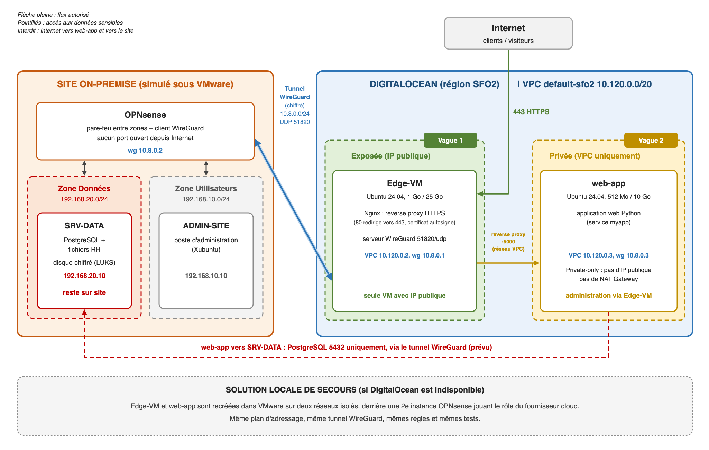

# Migration sécurisée vers une architecture Cloud hybride

Projet du module M352 "Sécurité de la virtualisation et du Cloud Computing" (ENSIASD), groupe G5, sous-groupe A, sujet 6.
Migration progressive d'un SI local vers le cloud public (DigitalOcean), avec les données sensibles gardées sur site et un tunnel WireGuard chiffré entre les deux.

## Changement de fournisseur cloud

L'architecture validée en Phase 2 était prévue sur Oracle Cloud (Always Free). La partie cloud est désormais déployée sur **DigitalOcean** (région SFO2), avec le même principe : une machine exposée, une machine interne sans IP publique, et le site on-premise relié par WireGuard. Sur Oracle Cloud, VM1 avait été créée mais la création de VM2 était bloquée par le manque de capacité Ampere A1 ; les captures de cette première étape restent dans [preuves/1-machines/](preuves/1-machines/).

## Architecture actuelle

Source modifiable : [docs/architecture_hybride_digitalocean.svg](docs/architecture_hybride_digitalocean.svg).

- **Seule Edge-VM est exposée** : elle reçoit le trafic HTTPS et le relaie vers web-app par le réseau privé du VPC.
- **web-app n'a pas d'IP publique** ("Private-only") et pas de NAT Gateway : elle ne peut ni être jointe depuis Internet ni y sortir directement. Son administration passe par Edge-VM.
- **Le tunnel WireGuard** (`10.8.0.0/24`, UDP 51820) relie le cloud et le site ; Edge-VM est le serveur.
- **Les données sensibles restent sur site**, dans la zone Données derrière OPNsense.

Le schéma validé en Phase 2 (version Oracle Cloud, adressage prévu à l'époque) reste disponible pour l'historique : [docs/architecture-v1-oci.png](docs/architecture-v1-oci.png).

## Machines

| Machine | Emplacement | Adressage | Rôle | État |
|---------|-------------|-----------|------|------|
| Edge-VM (VM1) | DigitalOcean, 1 Go / 25 Go | IP publique, VPC `10.120.0.2`, wg `10.8.0.1` | Nginx HTTPS (certificat autosigné), reverse proxy, serveur WireGuard | En service |
| web-app (VM2) | DigitalOcean, 512 Mo / 10 Go | VPC `10.120.0.3`, wg `10.8.0.3` | Application web Python (service systemd `myapp`) | En service |
| OPNsense | VMware | LAN `192.168.10.1`, Données `192.168.20.1`, wg `10.8.0.2` | Pare-feu du site, client WireGuard | En service, raccordement au tunnel à valider |
| ADMIN-SITE | VMware, zone Utilisateurs | `192.168.10.10` | Poste d'administration (Xubuntu) | En service |
| SRV-DATA | VMware, zone Données | `192.168.20.10` | PostgreSQL, disque chiffré LUKS | À installer |

## Plan de migration

1. **Vague 1** : les services exposés passent sur Edge-VM.
2. **Vague 2** : les services internes passent sur web-app.
3. **Vague 3** : les données sensibles restent sur site, accessibles uniquement depuis web-app via le tunnel (port 5432).

Solution de secours : si le cloud est indisponible, Edge-VM et web-app sont recréées dans VMware avec le même plan d'adressage.

## Avancement

| Partie | État | Preuves |
|--------|------|---------|
| Machines cloud | Edge-VM et web-app actives sur DigitalOcean | [preuves/digitalOcean/](preuves/digitalOcean/) |
| Site VMware | OPNsense et ADMIN-SITE en service ; SRV-DATA à installer | [preuves/1-machines/](preuves/1-machines/), [preuves/2-reseau/](preuves/2-reseau/) |
| Réseau | VPC privé entre les deux machines (ping Edge-VM vers web-app sans perte) ; zones Utilisateurs et Données sur le site | [preuves/digitalOcean/](preuves/digitalOcean/), [preuves/5-tests/](preuves/5-tests/) |
| WireGuard | Serveur sur Edge-VM avec 2 pairs (OPNsense, web-app) ; web-app connectée | [preuves/3-wireguard/](preuves/3-wireguard/), [configs/wg-server.conf](configs/wg-server.conf) |
| Services exposés | Nginx : redirection 80 vers 443, reverse proxy vers web-app | [preuves/6-services/](preuves/6-services/), [configs/nginx.conf](configs/nginx.conf) |
| Données | SRV-DATA à installer | |
| Audit Lynis | Avant durcissement : Edge-VM **59** (263 tests), web-app **62** (255 tests) ; audit "après" à faire | [tests/lynis/avant/](tests/lynis/avant/) |

## Contenu du dépôt

| Dossier | Contenu |
|---------|---------|
| [configs/](configs/) | Nginx (`nginx.conf`), WireGuard (`wg-server.conf`, `wg-client.conf`, `vm-web-wireguard.conf`), service systemd (`myAppService`), données fictives (`donnees-fictives.sql`) |
| [docs/](docs/) | Schéma d'architecture actuel (PNG + source SVG), schéma V1 Oracle, avancement, procédures WireGuard |
| [preuves/](preuves/README.md) | Captures rangées par partie, et [documentation de l'infrastructure DigitalOcean](preuves/digitalOcean/Documentation%20%E2%80%93%20Infrastructure%20DigitalOcean%20%28Edge-VM%20%2B%20web-app%29.md) |
| [tests/](tests/) | Tests à réaliser ([tests.md](tests/tests.md)) et audits Lynis ([lynis/](tests/lynis/)) |

Fichiers de la première étape Oracle Cloud, conservés pour l'historique : [configs/nginx-vm1.conf](configs/nginx-vm1.conf), [configs/wg0-vm1.conf.example](configs/wg0-vm1.conf.example), [docs/wireguard-ocinstance.md](docs/wireguard-ocinstance.md).

## Technologies

DigitalOcean, VMware, OPNsense, WireGuard, Nginx, Python (systemd), PostgreSQL, LUKS, Lynis.

## Équipe

| Membre | Rôle |
|--------|------|
| Haitam BELCAIDA (coordinateur) | Coordination et architecture, choix des outils et technologies, rapport, présentation, dépôt Git |
| Mohammed ELFADLAOUI | Création des VM (cloud et VMware) |
| Issam ELBAY | PostgreSQL et chiffrement LUKS sur SRV-DATA |
| Marouane BEKKAOUI | Réseau cloud, règles de filtrage, règles OPNsense |
| Abderemane ABDALLAH | Tunnel WireGuard |
| Hajar LAQLIB | Tests et preuves |

## Sécurité du dépôt

Dépôt public : aucune clé privée ni mot de passe. Les adresses IP publiques doivent être remplacées par des valeurs fictives (`<EDGE_PUBLIC_IP>`) et floutées dans les captures.
